# Saga de Midgard

Jogo de tabuleiro RPG em modo texto, feito em C, para o terminal.

- **Aluno:** IAN GABRIEL SARAIVA FERNANDES
- **Matrícula:** 20260042171
- **Disciplina:** DCT1106 - Programação (UFRN)
- **Professor:** Thommas K. S. Flores
- **Padrão da linguagem:** C99 (compilado com `gcc -std=c99`)
- **Vídeo de demonstração:** [Assista no Google Drive](https://drive.google.com/file/d/1SjgYq9vGdam9-AkVX19UomGz7yyYytZJ/view?usp=sharing)

---

## História

O Fimbulvetr chegou. O inverno eterno cobriu os nove mundos, o sol não nasce
mais e os rios viraram pedra. Dizem que o Visco Sagrado pode quebrar o inverno,
mas ele está com Baldur, o deus que nenhuma arma consegue ferir.

Você é um guerreiro exilado, sem clã e sem nome nas sagas. Atravesse Midgard,
enfrente os monstros de cada região e derrote Baldur para acabar com o inverno.

O tema foi inspirado na mitologia nórdica e no jogo God of War (2018).

---

## Personagens

O jogador escolhe uma classe no início e depois digita o nome do herói.

| Classe | Vida | Força | Defesa | Agilidade | Inteligência | Arma | Armadura | Habilidade |
|---|---|---|---|---|---|---|---|---|
| Guerreiro | 120 | 12 | 10 | 8 | 4 | Machado de Gelo (+3) | Couro Rústico (+2) | Fúria Gelada |
| Arqueiro | 105 | 8 | 8 | 14 | 6 | Arco de Freixo (+4) | Capa de Pele de Lobo (+1) | Flecha Certeira |
| Runista | 100 | 5 | 8 | 8 | 14 | Cajado de Runas (+4) | Manto Rúnico (+1) | Runa da Vida |

| Guerreiro | Arqueiro | Runista |
|---|---|---|
| 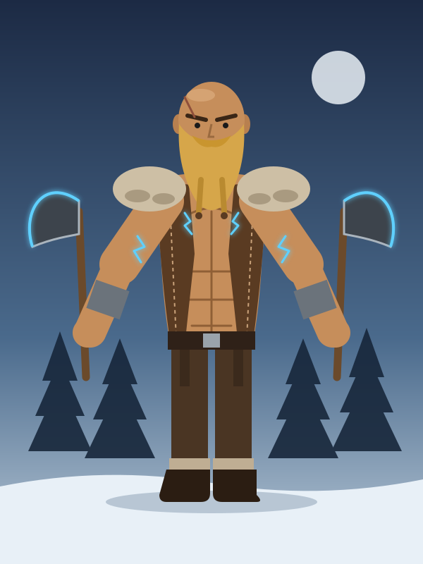 | 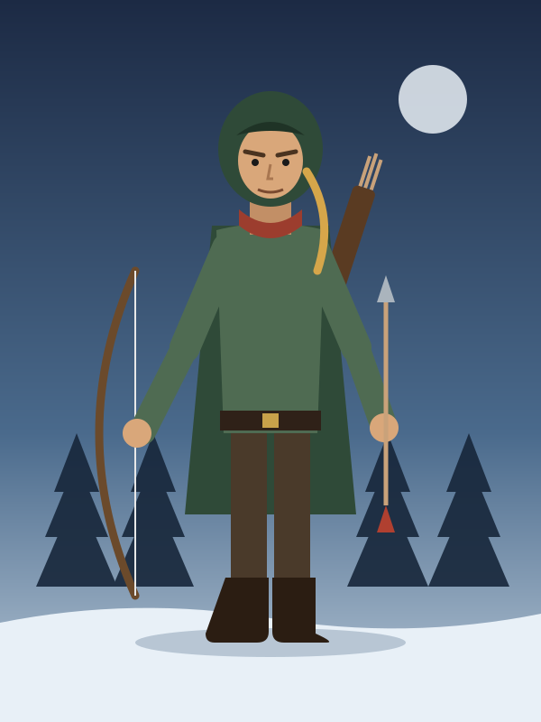 | 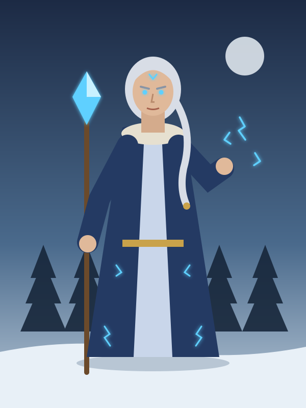 |

**Habilidades (uma vez por combate):**

- **Fúria Gelada (Guerreiro):** o ataque causa o dobro de dano.
- **Flecha Certeira (Arqueiro):** o tiro ignora a defesa do monstro.
- **Runa da Vida (Runista):** cura o herói em `inteligência × 2` de vida.

---

## Fases e monstros

O jogo tem **3 fases** e cada fase tem **3 monstros**. O terceiro monstro de
cada fase é o chefe e guarda a missão da fase. A vida e o ataque dos monstros
crescem a cada fase com um fator (1.0, 1.3 e 1.6).

### Fase 1 - Floresta Congelada (fator 1.0)

Missão: **Derrotar o Troll da Montanha**

| Monstro | Vida | Ataque | Defesa | XP |
|---|---|---|---|---|
| Draugr | 25 | 4 | 3 | 20 |
| Lobo Gelado | 30 | 5 | 4 | 30 |
| Troll da Montanha (chefe) | 55 | 7 | 5 | 60 |

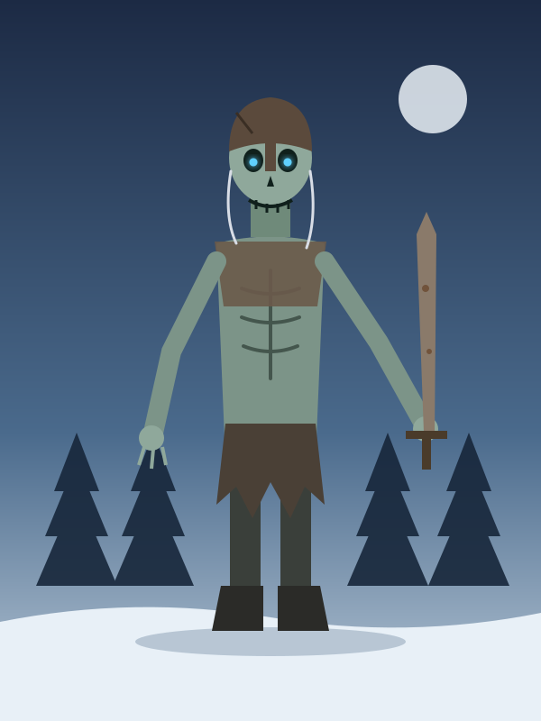 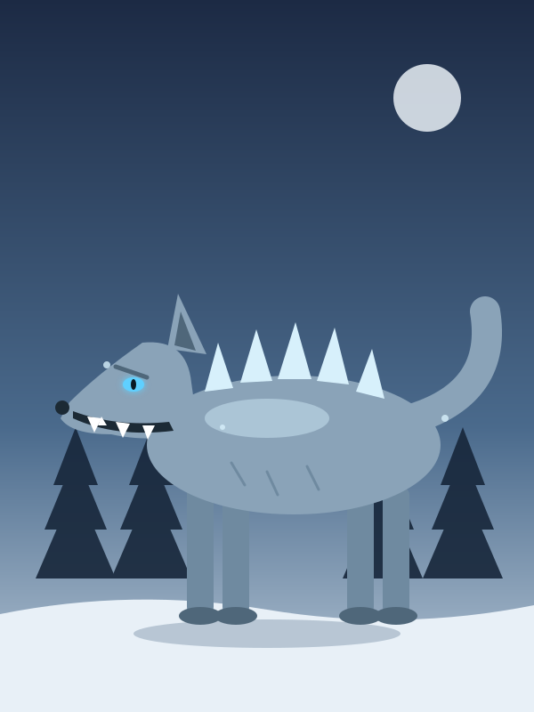 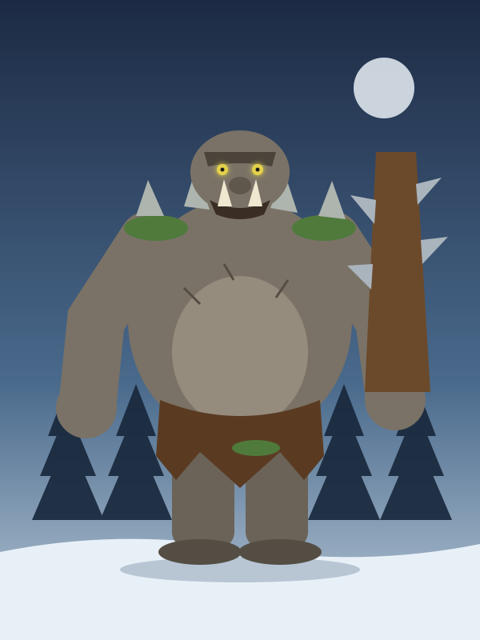

### Fase 2 - Lago dos Mortos (fator 1.3)

Missão: **Derrotar Jormungandr**

| Monstro | Vida | Ataque | Defesa | XP |
|---|---|---|---|---|
| Anão Sombrio | 39 | 8 | 5 | 35 |
| Valquíria Caída | 50 | 10 | 6 | 45 |
| Jormungandr (chefe) | 91 | 12 | 7 | 80 |

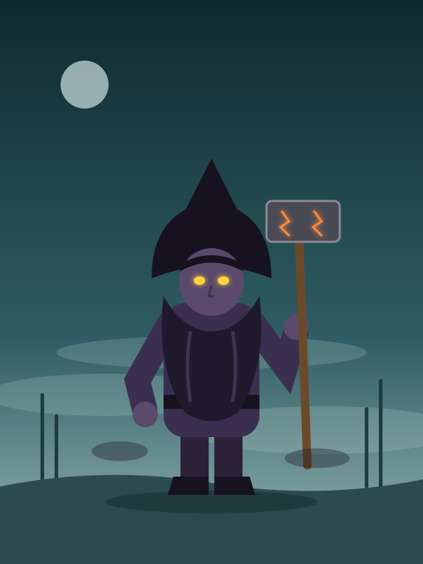 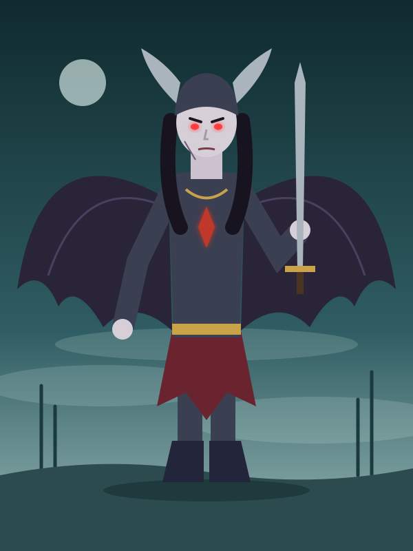 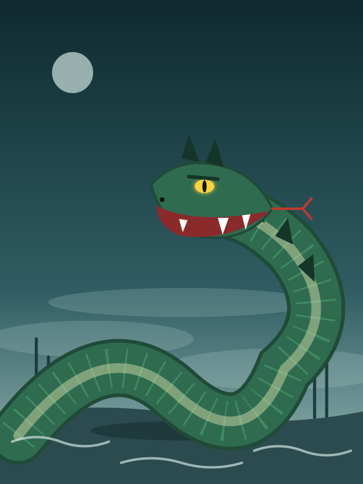

### Fase 3 - Montanha do Trono (fator 1.6)

Missão: **Derrotar Baldur**

| Monstro | Vida | Ataque | Defesa | XP |
|---|---|---|---|---|
| Gigante de Gelo | 58 | 12 | 7 | 50 |
| Guerreiro Eterno | 68 | 13 | 8 | 55 |
| Baldur (chefe) | 120 | 16 | 9 | 150 |

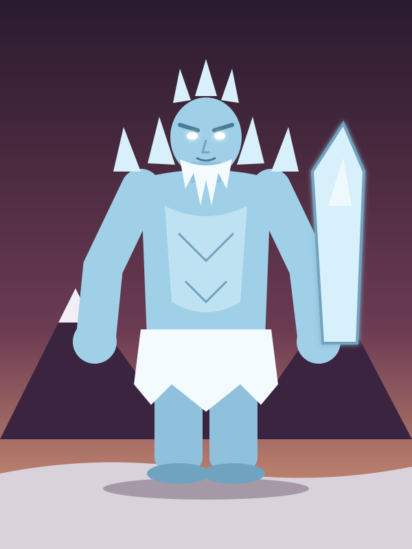 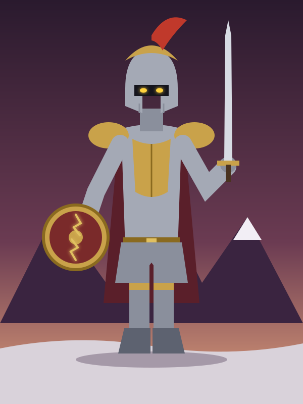 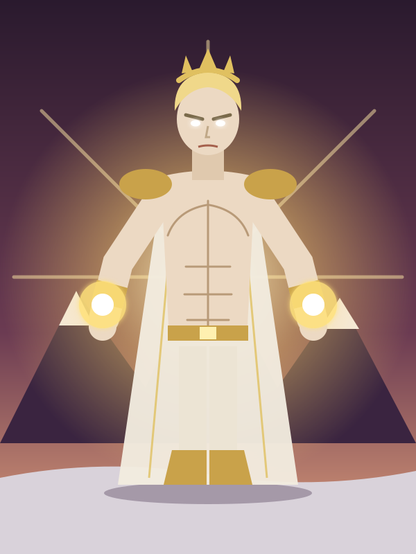

---

## Como o jogo funciona

### Tabuleiro

Cada fase tem um tabuleiro de **12 casas**. O herói começa na casa 1 e rola um
dado de 6 lados (d6) para andar. Se passar da última casa, ele para na última.

| Tipo de casa | O que acontece |
|---|---|
| Vazia | Nada acontece. |
| Combate | Luta contra um dos dois primeiros monstros da fase (sorteado). |
| Tesouro | Sorteio: ganha 30 de XP ou um bônus aleatório de atributo. |
| Cura | Recupera 40% da vida máxima. |
| Armadilha | Perde `5 + 3 × número da fase` de vida. |
| Missão | Luta contra o chefe. Vencer o chefe termina a fase. |

A casa 12 de cada fase é sempre a casa da missão.

### Combate por turnos

No seu turno o jogador escolhe uma ação:

1. **Atacar:** causa dano ao monstro.
2. **Defender:** o próximo golpe do monstro causa só metade do dano.
3. **Habilidade:** usa a habilidade da classe (uma vez por combate).
4. **Fugir:** rola um d6 e foge com 4 ou mais. A fuga não mantém o dano que o monstro causou.

Depois, o monstro ataca.

### Fórmulas

- **Ataque do herói:** `d20 + atributo da classe + bônus da arma`
  (Força para o Guerreiro, Agilidade para o Arqueiro, Inteligência para o Runista)
- **Dano no monstro:** `max(1, ataque do herói - defesa do monstro)`
- **Dano no herói:** `max(1, d20 + ataque do monstro - (defesa do herói + bônus da armadura))`
- **Escala por fase:** `vidaFinal = ceil(vidaBase × fatorFase)` e o mesmo para o ataque
  (função `ceil` da `math.h`)

### Progressão

- Ao vencer um monstro, o herói ganha o **XP** do monstro e um **bônus aleatório**
  (+1 em força, defesa, agilidade, inteligência ou +5 de vida máxima).
- O herói sobe de nível quando o XP chega a `nível × 50`. A cada nível:
  vida máxima +10, cura de 10 pontos, força +1 e defesa +1.

### Fim de jogo

- **Vitória:** derrotar Baldur, o chefe da fase 3.
- **Derrota:** a vida do herói chega a zero.

No final, o jogo mostra o resumo do herói.

---

## Como compilar e jogar

Você precisa ter o **gcc** instalado.

### Windows (PowerShell, na pasta do projeto)

```powershell
gcc -std=c99 -Wall -Wextra -o jogo src/main.c src/util.c src/interface.c src/personagem.c src/combate.c src/fases.c -lm
.\jogo.exe
```

### Linux ou macOS (terminal, na pasta do projeto)

Com o Makefile:

```bash
make
./jogo
```

Ou sem o Makefile:

```bash
gcc -std=c99 -Wall -Wextra -o jogo src/main.c src/util.c src/interface.c src/personagem.c src/combate.c src/fases.c -lm
./jogo
```

Para apagar o executável: `make clean`.

---

## Estrutura do projeto

```
projeto/
├── README.md
├── Makefile
├── src/
│   ├── main.c          # história inicial, escolha do herói e laço das fases
│   ├── tipos.h         # enums e structs (Personagem, Monstro, Fase)
│   ├── util.c / .h     # lerOpcao, limparBuffer, pausar, rolarDado
│   ├── interface.c / .h  # mostrarPersonagem, mostrarMonstro, menu de classes
│   ├── personagem.c / .h # criar herói, nome, receberDano, curar, ganharXP, bônus
│   ├── combate.c / .h  # cálculo de ataque e dano, combate por turnos
│   └── fases.c / .h    # criarFases, jogarFase, eventos das casas
├── images/
│   ├── personagens/    # guerreiro, arqueiro, runista
│   └── monstros/       # os 9 monstros
└── video/
    └── link_video.md   # link do vídeo de demonstração
```

## Conceitos usados

- **struct e enum:** `Personagem`, `Monstro`, `Fase`, `ClassePersonagem`, `TipoCasa`, `AcaoCombate`.
- **Ponteiros:** o status do herói é alterado por funções que recebem o endereço da struct
  (`receberDano`, `curar`, `ganharXP`, `aplicarBonusAleatorio`, `danoNoMonstro`).
- **Vetores:** o tabuleiro, as fases e os monstros de cada fase.
- **Funções e modularização:** cada função tem uma responsabilidade, e o código está
  separado em arquivos `.c` e `.h` com Makefile (bônus do enunciado).
- **Aleatoriedade:** `rand()` e `srand(time(NULL))` para os dados e os sorteios.
- **Bibliotecas:** só `stdio.h`, `stdlib.h`, `string.h`, `time.h` e `math.h`.
- **Tudo em memória:** o jogo não usa arquivos.

## Vídeo de demonstração

[Assista no Google Drive](https://drive.google.com/file/d/1SjgYq9vGdam9-AkVX19UomGz7yyYytZJ/view?usp=sharing)

O vídeo mostra a apresentação do jogo, a compilação no terminal, uma partida e a explicação de trechos do código. O link também está em [`video/link_video.md`](video/link_video.md).

## Sobre as imagens

As imagens dos personagens e dos monstros foram **desenhadas como arte vetorial
(SVG)** com a ajuda do Claude, um assistente de IA da Anthropic, e depois
exportadas para PNG. Elas não vieram de um gerador de imagens.
